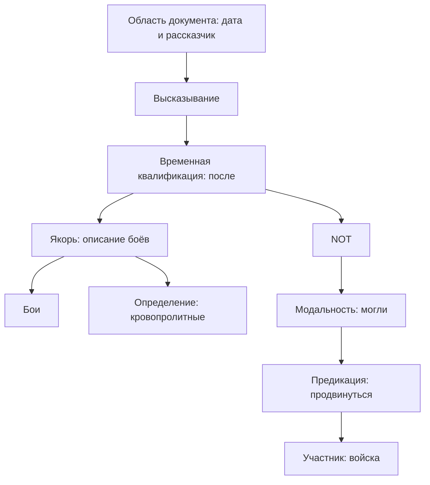

# Аудит композиции формализатора и целевое дерево

Дата: 2026-10-13. Проверенный коммит: `759fd789da0276085606bc9868e457063ac2d4fc` (совпадал с локальным `origin/temp`).

Статус: аудит baseline и последовательная реализация в рабочем дереве. Разделы 1–8 фиксируют исходные находки и целевую модель; актуальный результат и незакрытый остаток — в последних подразделах §9. Полный тестовый набор не запускался; целевые проверки и реальные разборы через T5/T6 с replay перечислены ниже. В последнем этапе добавлены целевые тесты совместных доменов. G0–G5 не меняются. Контракт кода: [COMPOSITION_RUNTIME_CONTRACT.md](COMPOSITION_RUNTIME_CONTRACT.md).

## 1. Главный вывод

Древовидные структуры уже присутствуют, но единого контракта композиции пока нет. Разные маршруты строят целые фрагменты разными способами, хранят связи в разных полях и ограничивают допустимую сложность дочернего содержимого. Поэтому наличие механизма для простого выражения ещё не означает, что оно разберётся внутри другого выражения.

Нужен общий алгоритм работы с типизированными слотами родителя и доменами дочерних вариантов. Грамматические механизмы определяют допустимые операции и ограничения. Глубина дерева не должна определять выбор другого алгоритма. Пробы выбирают локальную границу, связь, область действия или лексический вариант на любом уровне; модель не строит дерево самостоятельно.

Требование рекурсивности не означает безусловный выбор внешней структуры до чтения детей. Разбор идёт сверху вниз с обратным распространением ограничений снизу вверх. Иначе неверно выбранная граница снова уничтожит правильного кандидата.

## 2. Проверенный рабочий маршрут

`v7_pipeline.interpret_full` → `native_frontend.run_native` → морфологические варианты и регионы → `_grammar_frames` → `components.compose` → подготовка контекстных запросов → T3/seal/T4 → разрешение ссылок и source assertions → `native_plan` → T5/T6.

Основной режим — `region_probes`. Отдельный `legacy_proposal` ещё допускается конфигурацией. Наличие старого файла не означает его использование в основном маршруте: например, для `composition.assemble_ir` поиск по `src` нашёл определение, но не вызов. Некоторые типы из TP используются грамматическим кодом; удалять весь TP-пакет по имени нельзя.

Карта ниже группирует алгоритмы по функции, а не приравнивает каждый Python-файл к отдельному алгоритму. Подробно проверены активные точки композиции, области их применимости, порядок вызовов и места перечисления альтернатив. Это не утверждение о построчной проверке всех подсистем AH.

## 3. Распределение по уровням

Обязательное требование для дальнейшей разработки закреплено в V7 §0: до
реализации нового правила предложить уровень/тип узла, обосновать размещение,
указать входы/выходы, переиспользуемый механизм, место пробы, зависимости и
влияние на поиск. Простое и вложенное употребления обслуживаются одним
механизмом. Сквозная служба указывается явно вместо искусственного уровня.

Номера обозначают масштаб задачи, а не фиксированную глубину. Предикация может лежать внутри цитаты, именной группы или другой предикации; оператор может находиться на любой глубине при подходящем типе операнда.

| Уровень / служба | Существующие семейства алгоритмов | Целевая ответственность |
|---|---|---|
| L0. Источник и адресация | `documents/reading`, `regions`, `component_source`, `tag_source`, `reference_source_context` | Неизменяемый текст, адреса в источнике, принадлежность токенов. Пунктуация — свидетельство границы, не единственный критерий |
| L1. Область документа | `document_scopes`, `document_calendar`, `narrative_perspective`, `narrative_groups` | Дата, рассказчик и другие наследуемые параметры с независимыми условиями смены. Наследуются ссылки на окружение, а не копии всего контекста |
| L2. Границы и структура областей | `clause_detection`, `clause_boundary_candidates`, `soft_clause_boundaries`, `refinement_boundaries`, `component_refinement`, `component_infinitives` | Предлагать границы непосредственных детей и слоты включения. Вынести рекурсию, выбор и повторный пересчёт в общий диспетчер |
| L2–L3. Композиция пропозиций | `syntax_rules`, `region_probes`, `_grammar_frames`, `operator_algebra`, `scope_validation`, `quantifiers`, `component_coordination`, `coordination_scope`, `coordination_chains` | NOT, модальность, цитата, логическая координация, кванторы: типизированные родители с дочерними ссылками. Не отдельные разборщики каждой комбинации |
| L3. Предикация и аргументы | `component_clause`, `component_candidates`, `component_predication`, `component_nominal_utterance`, `component_participants`, `component_omissions`, `participial_roles`, `relative_pronoun` | Локальная схема предиката, роли и пропуски. Получать составной аргумент как ребёнка нужного типа |
| L4. Группы и зависимости | `component_phrases`, `component_prepositions`, `component_nominal_groups`, `nominal_group_member`, `component_dependency_*`, `component_nominal_questions`, `nominal_host_*` | Согласование, управление, GENITIVE, приложение, участники группы, непосредственный хозяин определения. Одна задача назначения связей с типовыми ограничениями |
| L3–L4. Модификаторы и вложенные описания | `component_modifiers`, `component_modifier_forest`, `component_nominal_tree`, `modifier_scope_shapes`, `component_scope_contrast`, `nominal_prefix_descriptions`, `nominal_residual_descriptions`, `implicit_descriptions`, `refinement_host_path`, `refinement_group_hosts`, `directional_goal` | Единый выбор хозяина/слота/области действия. Смысл разных отношений сохраняется; копирование поддеревьев и отдельные алгоритмы для их глубины устраняются |
| L4–L5. Количество | `qualitative_quantity`, `qualitative_group_entity`, `numeral_extraction`, `scalar_values` | Числовая группа или качественное количество как типизированный аргумент. «Несколько»/«много» сохраняются без выдуманных чисел |
| L4–L5. Временные выражения | `component_temporal`, `clock_expressions`, `clock_ranges`, `clock_range_evidence`, `named_periods`, `symbolic_temporal_bounds`, `_temporal` | Строить значение/описание времени. Различать момент, период, символическую границу и ссылку на событие. Не дублировать поиск области действия |
| Сквозная временная привязка | `component_temporal_scope`, `coordination_temporal`, `temporal_token_ownership`, `relative_time_plan`, `structural_content_time`, `temporal_*` | Присоединять временной ребёнок к подходящему хозяину общим механизмом. Лицензии вывода и запись свидетельств остаются отдельной семантикой |
| L5. Лексические варианты | `morph_evidence`, `lexical_snapshot`, `contextual_agreement`, `contextual_name_case`, `contextual_preposition_case`, `contextual_substantives`, `contextual_oov`, `contextual_oov_roles`, `naming_probe`, `open_set_*`, `t3_sources` | Общий домен вариантов конкретного употребления. OOV, морфология и семантическое связывание — разные ограничения, не один эвристический выбор леммы |
| Сквозная референция и память | `coreference`, `implicit_introduction`, `implicit_plan`, `nominal_reference_*`, `spatial_*`, `referential_placeholder`, `narrative_group_plan`, `attention_context`, `memory_service`, Ignition, `rx_cache` | По запросу любого узла искать контекст для слота. Различать неизвестный референт и неразрешённую ссылку на референт. Не превращать всю память в детей текущей области |
| Сквозной статус утверждения | `speech_act`, `source_assertions`, `support_som`, `usage_layer`, `nominal_usage`, `native_derivations`, `native_scope` | Определять, что утверждено, что лишь структурно доступно, что является вопросом/гипотезой. `native_scope` обслуживает контексты доказательства, а не ещё один синтаксический разбор |
| Вопрос и логический запрос | `interrogatives`, `native_questions`, `query_*`, `question_projection`, `goal_forms`, `goal_queries`, `native_queries`, `fact_query`, `if_query`, `count_reader`, `aggregate_count` | Использовать общее дерево содержания. Речевой акт выбирает компиляцию запроса вместо утверждения. Подсчёт ответов не является парсером числительных |
| Исполнение и долговечность | `native_plan`, `mutation_plan`, `graph_ops`, `t5_batch`, `t6_*`, `commit_stage`, `ah_adapter`, `canonical_ledger`, `proof_closure`, `goal_*`, `inference_*`, `migration`, `retraction`, `recovery`, `replay` | Проверять/компилировать результат, поддерживать опоры, admission, отзыв и recovery. Не переносить транзакции внутрь рекурсивного разбора |
| Инфраструктура | `state`, `candidate_ir`, `integration_ir`, `native_records`, `seal`, `run_binding`, `resources/*`, `component_probe*`, `selector_*`, `selection_*`, `provider_*`, `probe_windows`, `clarification*`, `telemetry`, `coverage`, `rx_observability` | Общие данные, ограничения, воспроизводимость, короткие пробы и наблюдаемость. Не ещё один уровень языковой структуры |

## 4. Дублирование, конфликты и ограничения композиции

Подтверждённое условие в коде не всегда равно доказанной регрессии на тексте. Ниже это различается явно.

| ID | Места / как устроено сейчас | Проблема | Целевое решение |
|---|---|---|---|
| C01 | `components.compose`: если хотя бы один предикат региона уже есть в grammar frames, компонентная обработка региона пропускается | Подтверждённое условие; риск потери непокрытого остатка при частичном grammar-match. Отдельный воспроизводящий прогон этого случая в текущем аудите не выполнялся | Grammar и components поставляют ограничения/продукции одного леса. Успех на одном ребёнке закрывает этого ребёнка, не весь регион |
| C02 | `component_area_scope.allowed` вызывается до уточнения области; допускает AND и распознанные временные конструкции, отклоняет остальные совпадения ScopeLexicon, цитаты и ряд знаков | Простой предикат разбирается, а тот же предикат под NOT/модальностью не достигает рекурсии. Это подтверждённая граница рабочего пути | Сначала кандидат родителя и его слотов, затем тот же разбор ребёнка. Неизвестная область действия остаётся переменной, а не глобальным отказом |
| C03 | `component_temporal.relative_adjuncts` требует PREP+NOUN без дополнительного содержания (`anchor_refs` длины 2) | «После завтрака» и «после кровопролитных боев…» обрабатываются некомпозиционно. Второй случай требует другой ветки вместо готового именного/событийного ребёнка | TEMPORAL_RELATION принимает описанный дочерний якорь нужного типа; его внутренние определения разбираются обычными правилами |
| C04 | `component_modifiers.scoped_bundle`, `component_modifier_forest.bundles`, `component_nominal_tree.bundles` — выбираемые конфигурацией стратегии | Три маршрута одной задачи упаковки зависимостей; они не работают одновременно, но имеют разное покрытие. В двух есть перестановки модификаторов | Один механизм назначения локальных связей и областей. Сохранить полезные детекторы/ограничения, убрать альтернативные диспетчеры полного разбора |
| C05 | `modifier_scope_shapes` перечисляет разбиения/комбинации; `coordination_chains` — длины поднимаемых префиксов и их чередования; `coordination_scope` отдельно строит обёртки над AND | Одна задача «к чему относится модификатор» реализована для одиночного события и координации отдельно. Уже собранное сложное дерево может отвергаться `inventory` | Общий домен хозяев/областей с ограничениями порядка. Ссылки на общие детей; без клонирования всех полных деревьев |
| C06 | `coordination_temporal.expand`: только один NAMED_PERIOD, два конъюнкта, отсутствие дополнительных wrappers | Время на простом AND и время на AND со вложенностью имеют разное покрытие | Временное выражение — типизированный ребёнок; хозяин выбирается тем же механизмом. Общий период не означает один общий момент событий |
| C07 | `component_refinement`, `component_infinitives`, `soft_clause_boundaries` независимо организуют границы, рекурсию и отказы | Разные языковые основания необходимы, но дублируется управляющий алгоритм. Refinement требует разрешённого родителя до присоединения ребёнка; infinitive имеет ограниченный набор контроллеров | Детекторы предлагают структурные ограничения общему планировщику. Control/согласование остаются отдельными грамматическими отношениями |
| C08 | `component_coordination.coordinate` требует ровно одного пригодного корня каждого конъюнкта до выбора общего scope | Здесь нет произведения всех полных альтернатив дочерних клауз: вместо этого неоднозначный ребёнок блокирует родителя. Родитель не может помочь разрешить ребёнка | Родитель принимает домены детей; ограничения распространяются в обе стороны. Проба ставится на спорной связи, а не обязательно на полном дереве |
| C09 | `component_dependency_domains` работает с ограниченным именным инвентарём; морфологические overlays срабатывают последовательно | Наличие ADJF-варианта в R1 не гарантирует его участие в конкретном вопросе зависимости. В дневнике обнаруживался NOUN-only домен для «городскому» | Морфологический выбор и тип связи — связанные переменные. Согласование и управление фильтруют один домен употребления, а не разные локальные копии |
| C10 | `qualitative_quantity` распознаёт локальную количественную группу; `scalar_values`/`numeral_extraction` существуют отдельно | Нет общего композиционного пути от сравнения и составного количества к именной группе. Ранее наблюдался пробел «более двадцать тысяч пленных» | Скалярное сравнение принимает количественного ребёнка, тот — счётную группу. Качественные значения остаются буквальными; арифметика не изобретается |
| C11 | `component_temporal_scope` отдельно пробует SOURCE_ASSERTED/EMBEDDED и отклоняет вложенную временную ветку; `source_assertions` позднее проверяет утверждение содержимого lexical modifier | Перекрывающаяся работа со статусом утверждения через разные специальные маршруты. Утверждение порядка событий и утверждение самого события всё же разные факты | Единый контракт статуса и оснований у связей/корней; отдельные лицензии для содержимого и времени. Проба уточняет конкретную лицензию, не назначает истинность автоматически |
| C12 | Coref/implicit/spatial/nominal контекстные запросы основной frontend готовит после построения структур | Контекст может помочь ссылке, но общий механизм запроса недостающего контекста из незавершённого узла разбора отсутствует | Узел создаёт адресную потребность в памяти; ответ уточняет его домен и зависимых родителей. Сохраняются receipts и frozen snapshot |
| C13 | `directional_goal.bundle` ищет специальный случай двух модификаторов и вручную переподключает frame-связи | Семантический вопрос «одно ли место описывают два выражения» полезен; отдельная перестройка конкретной формы дерева плохо масштабируется | Совместимость/тождество целевого референта — ограничение двух слотов общего дерева, с сохранением неизвестного места и относительного направления |
| C14 | `source_assertions` обходит несколько представлений: logical_roots, operator_forest, component_scope_tree, proposition_args, nominal_args; координация распознаёт frame по префиксу ID | Потребители зависят от того, каким алгоритмом построено поддерево, а не только от его типа и интерфейса | Один способ перечислить детей, слоты, область действия, основания и статус. ID не должен кодировать способ обхода |

### Что не следует объединять по поверхностному сходству

- AND пропозиций и группа участников используют общий механизм координации, но имеют разные выходные типы и семантику.
- NOT, POSSIBLE, QUOTED и обычное определение могут иметь одного ребёнка; их лицензии утверждения различны.
- Дата заголовка и рассказчик наследуются через окружение, но имеют разные критерии начала/окончания области.
- Морфологическая гипотеза для OOV не равна доказанному lexical sense или identity linking.
- Разбор временного выражения, присоединение времени, создание TimeAssertion и временная лицензия вывода — разные операции.
- Относительное направление к неизвестному месту не доказывает координаты, прибытие или identity с известной локацией.
- Общий механизм выбора не означает одинаковые основания для всех проб. Синтаксическое основание не заменяет O/C/W truth-ground.

## 5. Целевое дерево

### 5.1. Контракт узла

Это логический контракт эволюции RegionForest/FrameCandidate, а не предложение добавить рядом третий независимый IR.

| Поле | Смысл |
|---|---|
| `node_id`, `source_refs`, `owned_token_refs` | Стабильный адрес кандидата/области; span может охватывать разрыв, поэтому реальное владение задаётся токенами |
| `output_sort` | ENTITY_DESCRIPTION, GROUP, EVENT_DESCRIPTION, PROPOSITION, TIME, QUANTITY и другие явно объявленные типы; это типы разбора, не готовые AH Ref |
| `construction_domain` | Допустимые родительские операции из ресурсов и общих структурных правил |
| `slots[]` | Имя/тип слота, ссылка на ребёнка либо домен дочерних вариантов; произвольная глубина при совместимом типе |
| `constraints[]` | Согласование, управление, покрытие, допустимый scope, control, порядок и совместимость интерпретаций |
| `environment_refs` | Дата, рассказчик, дискурсивный контекст, binders; локальное затенение вместо копирования всего окружения |
| `obligations[]` | Неразрешённая граница, хозяин, ссылка, лицензия, sense; адресуемые задачи для памяти/пробы |
| `grounds`, `usage_status` | Основания выбора и независимый статус утверждения/структурного использования; локальная лицензия не теряет внешнюю область NOT/QUOTE |
| `dependency_versions`, `resolution` | Зависимости решения и кэша; различимые resolved/ambiguous/unresolved/incomplete/blocked состояния |

Каждый токен должен иметь объяснённую роль в выбранном разборе. Служебное слово может принадлежать конструкции, согласовательная ссылка — пересекать детей. Это не разрешение дважды потребить токен в несовместимых ролях. Межветочные ссылки не нужно подменять копированием поддерева или сущности.

### 5.2. Пример произвольной вложенности

«После кровопролитных боев войска не могли продвинуться».

Ниже один кандидат области действия времени. Если текст допускает несколько областей, на соответствующей связи остаётся выбор. Схема — дерево разбора, а не буквальный набор G/N в AH. В частности, значение «могли» требует своего выбора sense и не обязано автоматически компилироваться в эпистемический POSSIBLE.

«Бои» с любым числом корректно разобранных определений дают тот же выходной тип, что простой якорь. NOT принимает результат ребёнка без проверки, простой там предикат или сложная модальность. Модальность принимает предикацию по типу. Существование структурного якоря и дочерних узлов само по себе не утверждает их истинность.

Дети могут содержать новые предикации: цитату внутри цитаты, относительную клаузу внутри именной группы, отрицание внутри относительной клаузы. Их разбирает тот же диспетчер. Ограничения глубины/бюджета отражают неполноту поиска, а не вводят семантическое правило «такая вложенность невозможна».

### 5.3. Неоднозначность вложенности

Для «Пил чай и обедал в поезде» возможны, например:

1. `LOCATION(AND(P,Q), поезд)` — место относится к обоим действиям.
2. `AND(P, LOCATION(Q, поезд))` — только к обеду.

P, Q и описание поезда разбираются по одному разу. Отличается назначение области действия LOCATION. По согласованному уточнению V7 §4.8 одна лишь логическая возможность второго дерева не останавливает формализацию: при установленной координации, применимости модификатора и отсутствии контекстного основания разделить действия предпочитается первый, общий вариант. Это прагматическая интерпретация, сохраняющая основание и возможность пересмотра, а не доказательство единственного намерения автора.

Перед введением неопределённости задаётся вопрос: «Как именно в человеческой речи эта неоднозначность может быть убрана?» Проба при необходимости ищет разделяющие признаки в доступном контексте, а не требует недостижимой математической однозначности. Она получает локальные различия и не формирует P/Q или JSON дерева заново. Общая LOCATION не означает одновременность действий. Ошибки, незамкнутая структура и неполный обязательный поиск этим предпочтением не исправляются.

Для более сложной координации область может быть подгруппой детей. Домен подгрупп ограничивается грамматическими и контекстными основаниями; нельзя механически перечислять все подмножества и все перестановки. Зависимые выборы связываются ограничениями: независимые локальные победители не всегда составляют совместимое глобальное дерево.

При нескольких вариантах хранится компактный лес альтернатив с общими поддеревьями. Каждое выбранное композиционное прочтение древовидно; техническое совместное хранение образует DAG. Итоговая память остаётся гиперграфом, поскольку identity, кореференция, временные и причинные связи пересекают ветви. Это три разные структуры, а не отказ от дерева разбора.

## 6. Единый порядок работы

1. Сохранить текст, варианты слов и наследуемое окружение. Не выбрать предикат или лемму только потому, что они первыми подошли.
2. Предложить непосредственных родителей/границы по общим правилам. Пунктуация участвует как одно из оснований; несколько границ остаются адресуемыми.
3. Для каждого слота запросить ребёнка нужного типа через общий диспетчер. Дочерний разбор кэшировать вместе с зависимостями; не пересобирать для каждого родителя.
4. Распространить типовые и грамматические ограничения в обе стороны. Однозначные связи убрать из дальнейшего выбора, сохранив их основания. Не удалять связанные слова из исходного дерева.
5. Неразрешённому слоту дать обратиться к памяти через общий сервис. Контекст — адресный результат запроса, не материализация всей активной памяти внутри дерева. После проверки доступных разделяющих признаков применить объявленные прагматические предпочтения: нейтральное умолчание контекста не требует бесконечного поиска доказательства невозможности всех других прочтений.
6. Если ограничений недостаточно, задать короткую пробу про конкретную неопределённость. Границы, тип связи, scope, control и identity могут потребовать разных проб, но используют общий протокол выбора.
7. При изменении домена пересчитать только зависимые узлы. Отсутствие подходящего кандидата отличать от неизвестного ответа и от исчерпания бюджета. NONE_FIT не разрешает выбрать первый вариант или отвергнуть ещё не исследованный источник кандидатов.
8. После стабилизации проверить совместимость выбранного целого, покрытие и лицензии утверждения. Разрешённый ребёнок не обязательно является самостоятельным утверждаемым фактом. Частичный коммит допускается только при доказанной независимости и соблюдении текущего контракта фрагментов.
9. Выполнить единое lowering в MutationPlan и прежний T5/T6. Транзакции, provenance, UsageLink, TimeAssertion, admission и recovery сохраняются.

Неоднозначность родителя не должна автоматически стирать результат ребёнка. Но и успешный ребёнок не должен автоматически обходить родительский NOT, QUOTED или вопрос.

### Ignition и повторные уточнения

Внешняя последовательность чтения остаётся событийной. Перестройка внутреннего кандидата не означает, что человек «прочитал ещё один фрагмент», и не должна повторно продвигать source-clock. Потребность в памяти привязывается к source event и конкретному слоту; receipts воспроизводимы. Новое чтение контекста при разрешённой новой версии и replay прежней версии — разные операции.

Замена границы или хозяина инвалидирует зависимые решения/основания. Неизменённые дети повторно не разбираются. Это особенно важно для большого документа: дискурсивное окружение передаётся по ссылкам, а локальные структуры не требуют декартова произведения с каждым предыдущим абзацем.

## 7. Сложность

Источники дорогого поиска, подтверждённые в baseline (статус удаления — §9):

- `component_modifier_forest`: перестановки модификаторов; произведение морфологических вариантов определений.
- `component_nominal_tree`: перестановки event-модификаторов либо перечисление topology через `modifier_scope_shapes`.
- `modifier_scope_shapes`: разбиения множества и произведения дочерних вариантов.
- `coordination_chains`: сочетания длин поднимаемых префиксов и допустимые чередования; локальный порядок уже сохраняется, что полезно, но вариантов всё равно может быть много.
- Полные bundles создаются до `component_scope_contrast`: короткая итоговая проба не отменяет стоимость предварительного построения.
- Напротив, `component_coordination` сейчас обычно требует уже однозначных детей; его проблема — преждевременная блокировка, а не перебор декартова произведения полных детских разборов.

Цель — считать и сокращать домены локальных решений, разделять общие поддеревья, запускать повторно только затронутые ограничения и материализовать полное выбранное представление позже. Бюджет не должен молча превращать неисследованные варианты в невозможные.

Обход уже выбранного дерева имеет стоимость O(V+E). Стоимость поиска дерева этим не ограничивается: неоднозначная грамматика и взаимозависимые альтернативы могут давать тяжёлые случаи даже при компактном хранении. Ни универсальную линейность, ни полноту русского языка одна древовидность не доказывает. Здесь устранение явного факториального перечисления — конкретная инженерная цель, а не обещание невозможного.

## 8. Порядок перехода

| Шаг | Изменение | Проверка на действительном разборе |
|---|---|---|
| 1 | Единый интерфейс ребёнка/слота поверх текущего IR; единый обход без префиксов frame_id | Одно и то же уже принятое поддерево читается T5, вопросами и scope-проверкой одинаково |
| 2 | Родительские операторы до локальной композиции; заменить глобальный component scope guard адресными обязательствами | Простой предикат, NOT над ним, модальность под NOT, вложенная цитата — один дочерний разбор |
| 3 | Временной/пространственный аргумент принимает составную группу; общий механизм attachment | «После завтрака» → «после кровопролитных боев…»; неизвестное место с описанием не дублируется |
| 4 | Объединить assignment хозяев и scope для модификаторов, координации и времени; хранить альтернативы до materialize | «Пил чай и обедал в поезде»; тот же родитель с уже сложным ребёнком |
| 5 | Общий домен морфологии и зависимостей; составные количества и control подключить как продукции/ограничения | «городскому саду», «более двадцать тысяч пленных», явный и неявный контроллер инфинитива |
| 6 | Адресная память из любого незавершённого узла; единая проверка статуса утверждения | Дневниковый рассказчик/группа, «там», временной якорь внутри модальности; replay не двигает чтение повторно |
| 7 | После сохранения покрытия убрать заменённые диспетчеры и изолировать legacy | Повтор фактических фрагментов дневника и ранее охваченных структур без словарных патчей под предложения |

Это перенос полезных правил в общий композиционный механизм. Новый обработчик `NOT+clause`, `temporal+NOT+clause` или `coordination+temporal+NOT` не нужен. Нужны отдельные правила самих отношений и проверка совместимости их интерфейсов.

## 9. Результат переработки и оставшиеся границы

Изменения находятся в рабочем дереве относительно указанного baseline. Нельзя
читать исходную таблицу C01–C14 как описание уже изменённых файлов.

| Пункт | Что изменено | Что не объявляется закрытым |
|---|---|---|
| C01 | Покрытие проверяется у цельной grammar-альтернативы, не у объединения разных гипотез; `CompositionSources` индексирует готовые поддеревья для общего рекурсивного входа; неполные исходные frames остаются только для аудита | Grammar и components ещё не разделяют единый packed forest; повторный разбор остатка не устранён полностью |
| C02 | Унарные операторы и QUOTED-аргументы разбирают детей через общий вход; NOT извлечён из строковых эвристик планировщика/запросов | Общий механизм границ для всех бинарных, кванторных и неделимитированных конструкций; несколько конечных модальных управляющих в одной области |
| C03 | TEMPORAL_NOMINAL принимает EVENT_DESCRIPTION со всем именным поддеревом | Полнота всех способов выражения временного якоря не доказана |
| C04 | Три альтернативные стратегии заменены `component_nominal_tree` + `scope_assignment`; старые генераторы удалены | Морфологические joins и покрытия единиц всё ещё bounded, не packed |
| C05 | Одна задача вставки scope-связи для одиночного ребёнка/AND; нет перечисления перестановок полных деревьев; есть непрерывные подгруппы n-арного AND; нерешённое ребро откладывается до изменения дерева, без остановки независимых связей | Общая совместимость произвольных отложенных scope-решений; локальная проверка DAG не заменяет такого solver |
| C06 | `temporal_attachment` использует тот же scope-domain, без условия «ровно два конъюнкта и без wrappers» | Перекрывающиеся временные грамматики и несколько конфликтующих датировок пока дают явный отказ |
| C07 | Один рекурсивный вход/кэш; typed request, явный одиночный/групповой и неявный control; обязательный proposition-слот резервируется до подключения ребёнка | Полный общий планировщик границ/незавершённых родителей и вложенных цепочек control |
| C08 | Единый `DomainNetwork` распространяет ограничения по соседним доменам; родитель уточняет полный домен или возобновляет незавершённого ребёнка через `ChildTasks`; решённые пробы переиспользуются | Общего глобального решения произвольных межобластных ограничений нет; дуговая согласованность сама не гарантирует совместимого целого |
| C09 | ATTRIBUTE и именные чтения участвуют в общем домене; PP сохраняет чтение головы для согласования с определением; ROOT-координация участников включена в тот же редуктор зависимостей | Все overlays ещё не сведены в одну глобальную переменную употребления; полный дневниковый фрагмент ниже не закрыт |
| C10 | Числовые и качественные количества — один дочерний AST с SEQUENCE/QUALIFIED; текст и неопределённость сохраняются, «двадцать человек» закоммичено | Поддержано согласование косвенного количества с головой и определения между ними; не закрыты вложенные разрядные существительные, предложные количества и все численные запросы |
| C11 | Временной якорь больше не имеет собственного source-assertion composer; проекция main-clause задаётся типом связи и проверенной границей | Новые логические лицензии не изобретаются; произвольные лексические модификаторы требуют source assertion probe |
| C12 | STRUCTURE-запрос к AttentionContextReader доступен до seal; frozen receipt/кэш области | Это чтение активного контекста, не произвольный GOAL solver по всей памяти |
| C13 | `directional_goal.constrain` задаёт ограничение слота до материализации; нет special rewrite пары wrappers | Новая ветка ещё не подтверждена отдельным живым проходом |
| C14 | Общий вид slots/forests/leaves используется компиляторами и source_assertions; DAG/closure; AND возвращает один носитель выражения, подключение дочернего forest переведено в общий `internalize` | Сериализованные поля старого IR сохранены для replay; это адаптерный единый вид, а не миграция всех исторических записей |

### Фактические проверки

Использовался явный TEST_ONLY release и настоящий `interpret_full` с AH,
MutationPlan и T5/T6. Короткие пробы отвечались по их тексту, без передачи
формализатору готового графа. Это проверка контура, не измерение качества LM Studio.

- «Пил чай и обедал в поезде.» — общий scope LOCATION над AND, APPLIED;
  старый независимый локальный корень обеда не утверждается повторно.
- «После кровопролитных боев войска продвинулись.» — описанный именной якорь,
  AFTER + разрешённая проекция главной клаузы, APPLIED; якорь структурный.
- «Иван не спал.» — NOT в дереве, APPLIED.
- «Иван сказал: „Пётр не спал“.» — SAY с QUOTED-ребёнком NOT, APPLIED;
  цитата не становится самостоятельным фактом о сне.
- «Иван мог не спать.» — POSSIBLE(NOT(...)), APPLIED.
- «Принял двадцать человек.» — количественная группа с исходным выражением,
  APPLIED без выдуманного распределения участников.

В завершающем проходе «После кровопролитных боев войска не могли продвинуться»
дало `AFTER(NOT(POSSIBLE(...)), anchor)` и APPLIED. После восстановления журнала
корневые опоры — AFTER и NOT; положительное продвижение и событие-якорь не
получили корневой опоры. «Иван обещал прийти» в том же входе осталось неразрешённым
на видовом домене perf/impf родителя; это не объявлено успешной формализацией.

Для завершённых прогонов повтор того же входа сохранил batch_hash и committed
fragments, не изменил ledger, не добавил provider calls и тики Ignition. Эти
шесть проверок replay не равны проверке всей семантики русского языка.

Дневниковый фрагмент «Смотрели на игры двадцать мальчиков, знакомых Алексея по
городскому саду. Пил чай и обедал в поезде.» остался частичным: вторая клауза
коммитится, первая имеет неразрешённую зависимость количества/номиналов. Во
входе действительно написано «двадцать», а не «двадцати». Молчаливого исправления
морфологии или выбора первой связи не сделано. Этот прогон не считается полной
формализацией дневника.

### Следующий необходимый шаг

Для C08 добавлены общий движок локальных доменов и возобновление ребёнка с
ограничением родителя. Остаток C01/C07/C08/C09 — общий домен для разных источников
грамматики, всех морфологических overlays и взаимозависимых границ; локальная
очередь ограничений не выдаётся за завершение этой работы. Нельзя закрыть его новым
обработчиком конкретной дневниковой строки. Старые факториальные генераторы уже
удалены; вернуть их как fallback было бы регрессией архитектуры.

Ни отсутствие регрессий на всём корпусе, ни завершение всех пунктов аудита,
ни G0/G5 PASS в этом отчёте не заявляются.

### Продолжение: домены и вложенный AND

Уровень изменения — служба доменов/ограничений между типизированными слотами.
Она не зависит от слова, формы NOT или глубины вложения. Грамматические правила
поставляют отношения совместимости, `DomainNetwork` обрабатывает затронутые дуги;
при отсутствии прогресса остаётся адресованный остаток. `ChildTasks` повторно
вызывает незавершённого ребёнка при новом родительском контексте, переиспользуя
решённые пробы. Повтор не обходит budget/resource/integrity-отказы. Уточнения
именной области переведены на тот же `select_child`, что цитата и инфинитив.

Выявлен и исправлен дефект границы: AND с несколькими лексическими листьями
возвращался как несколько независимых корней, отчего следующий родитель не мог
принять его единым ребёнком. Теперь служебный носитель хранит полное выражение.
Подключение вложенного forest унифицировано в `composition_tree.internalize`;
это предотвращает появление самостоятельного утверждения из промежуточного
операторного дерева внутри цитаты, уточнения или инфинитивного дополнения.

Фактический проход `tree_domains_live`, затем повтор точных записанных запросов
на окончательном коде `tree_domains_final`: «Иван сказал: „Пётр не спал и читал
книгу“», «Принял доклад Макарова — министр юстиции», «Пил чай и обедал в поезде».
16 коротких проб, APPLIED, четыре коммитнутых фрагмента, активных диагностик нет.
В журнале корневая опора SAY с содержимым `AND(NOT(спал), читал)`; отдельной
корневой опоры содержимого цитаты нет. Дневниковая именная цепочка сохранена;
LOCATION имеет общий scope над AND. Шесть проверок native replay пройдены,
провайдерных вызовов и тиков не добавилось. Это проверка пути исполнения с
TEST_ONLY ресурсами и внешними ответами, не измерение качества локальной модели.

Количественная именная группа теперь имеет раздельные внешнее и внутреннее
чтения (`nominal_readings`). Приложение строит и проверяет единая лицензия
`nominal_apposition`; согласование с HEAD-слоем включено в тот же DomainNetwork.
Это устранило прежнее отсутствие APPOSITION для «знакомых» в исходном
«Смотрели на игры двадцать мальчиков, знакомых Алексея по городскому саду».
Материализация также проверяет контекстуальную субстантивацию по исходному
ADJF и её Decision, вместо поиска уже выбранного NOUN только в словаре.

Фактический проход `tree_nominal_live` (финальные байты кода повторно проверены
в `tree_nominal_verified` с точными сохранёнными запросами/ответами): 13 коротких проб, 7 frames, APPLIED,
2 корневых фрагмента, диагностики пусты. В ledger присутствуют SYNTAX_APPOSITION
между группой мальчиков и знакомыми, SYNTAX_GENITIVE от знакомых к Алексею,
описание «по городскому саду» у знакомых и лексическое количество «двадцать».
Синтаксические описания связаны через NOMINAL; они не создают identity.
Оба морфологических чтения сохранены в interpretation. Шесть проверок
native replay прошли: без новых вызовов, тиков или изменения ledger.

Граница результата: это изолированная фраза с допустимым чтением «двадцать
мальчиков» как субъекта. Она не доказывает авторское намерение во всём дневнике.
Исходное «двадцать» не заменено на «двадцати»: вариант «игры двадцати мальчиков»
потребовал бы отдельной лицензии восстановления формы/уточнения и контекста.
Проход использует TEST_ONLY release и внешнего исполнителя закрытых проб;
качество/скорость локальной модели этим не измерены. Правила с лексикой дневника
не добавлялись. Ресурсный контракт и placement описаны в COMPOSITION_RUNTIME_CONTRACT.

Проверка возобновления (`tree_scope_resumed`): «Иван сказал: „Пётр увидел друга
с биноклем“». Три исходные пробы и одна повторная с родительским ограничением.
Повторена только неразрешённая привязка PP; выбор объекта и QUOTED-слота не
перезапрошен. Уточнение QUOTED не различает хозяев PP, поэтому обе попытки
сохранили INSUFFICIENT_CONTEXT. Итог RESOLUTION_ONLY, без коммита факта;
предыдущий ответ сохранён в `attempts`, событие PARENT_CONSTRAINT_RECHECK — в
истории Decision. Шесть проверок native replay пройдены. Эта проверка выявила
и устранила ранний возврат прежнего UNKNOWN в `component_nominal_questions`.

Дополнительный проход «Иван сказал: „Пётр видел друга брата соседа“» подтвердил
материализацию цепочки именных зависимостей внутри QUOTED (APPLIED, диагностики
пусты, native replay пройден). Короткий исполнитель выбрал обычную последовательную
цепочку по исходному тексту; готовый граф на вход формализатора не подавался.

Повтор прежних конструкций после подключения лицензии приложения
(`tree_apposition_regression`): 16 коротких проб, APPLIED, 4 фрагмента,
диагностики пусты. В фактическом ledger корневые опоры принадлежат SAY,
«Принял», общей области «в поезде» и source-asserted AND двух действий.
Вложенные NOT/AND цитаты не получили самостоятельных опор. Приложение
«Макарова — министр юстиции» и цепочка GENITIVE сохранены. Все шесть проверок
native replay прошли. Это адресная проверка изменённого пути, не полный
прогон дневника и не подтверждение G0/G5 или качества локальной модели.

### Проверка реестра, групп и отложенного scope

Проверяется исполнение на небольших реальных текстах с TEST_ONLY release,
внешними короткими ответами и собственным native replay. Это не измерение
качества локальной модели, не массовый тестовый корпус и не G0/G5 PASS.

| Артефакт запуска | Вход / подтверждённый результат |
|---|---|
| `tree_sources_regression_final` | Цитата с NOT/AND, «доклад Макарова — министр юстиции», общий LOCATION у «пил чай и обедал». На финальном коде воспроизведены точные прежние запросы/ответы: APPLIED, 4 фрагмента, 16 проб, replay без новых вызовов/тиков/изменений ledger |
| `tree_groups_quantity_live` | «Иван и Пётр приняли доклад Макарова. Помог двадцати знакомым мальчикам». APPLIED, 2 фрагмента, 5 проб. Одна K-группа субъекта, GENITIVE у доклада; дательное количество и отдельное описание «знакомым», исходное «двадцати» сохранено, без вычисления cardinality. Replay пройден |
| `tree_scope_deferred_verified` | «Иван очень быстро читал книгу. Иван пришёл». Неподходящая начальная привязка «очень → читал» получает NONE_FIT; после независимого «быстро → читал» доступно «очень → быстро → читал». APPLIED, 4 фрагмента, 7 проб, replay пройден. Во втором предложении сохранён полный GRAMMAR-кандидат. В state остаётся диагностический отказ несовместимой альтернативы предиката; в commit receipt ошибок нет |
| `tree_group_control_final` | «Иван и Пётр решили читать доклад Макарова». APPLIED, один root-фрагмент, 5 проб (первые три — точные записанные ответы; две изменённые пробы отвечены заново). У решения и структурного чтения один K UID, зависимость Макарова от доклада; единственная root-опора на решении, не на состоявшемся чтении. Replay пройден |

Дополнительно при сверке контракта исключён свободный субъект из домена
управляемого ребёнка: он уже задан выбранным controller. Количественная
метаинформация копируется вместе с исходными упоминаниями, а не теряется
при повторном использовании аргумента.

Остаток по шести направлениям: общий packed-домен всех источников и overlays,
бинарные/кванторные границы и несколько модальных управляющих, конфликтующие
временные чтения и полноценный типизированный GOAL во время разбора.
Текущий STRUCTURE-reader уже выполняет событийный поиск в Ignition и сохраняет
receipt, но не компилирует незавершённый слот в задачу логического вывода.
Прямое подключение записывающего goal-канала к frozen чтению не выполнено:
оно изменило бы memory_hash внутри той же интерпретации. Для этого нужен
read-only proof-контракт на активной области либо явная граница изменения
снимка. Глобальное чтение AH в обход Ignition не добавлялось.

### Продолжение 14.10: внешние границы и совместный выбор именного чтения

Завершена проверка предыдущего блока: `tree_outer_complete_final` — пять фраз
с двумя модальными управляющими в соседних конъюнктах, внешним POSSIBLE над AND,
раздельными утром/вечером, диапазоном часов и символическим временем без даты.
27 коротких проб, APPLIED; native replay пройден. `tree_outer_regression` —
цитата с NOT/AND, приложение после тире и общий LOCATION: 18 проб, APPLIED,
4 фрагмента, replay пройден. Это не проверка произвольных цепочек модальных
управляющих или всех конфликтов временной грамматики.

Новый механизм размещён на уровне именной группы/зависимого слота. Вместо
раннего выбора NOMINAL/ADJECTIVAL исходный ADJF и предложенный NOUN участвуют
в одном домене связи. Редуктор учитывает выбор хозяина, единственность роли и
согласование; источник R1 не меняется. Лицензия нового именного употребления
привязана к выбранному кандидату. `finalize` и материализация проверяют её
действительность. Неопределённый ответ не даёт лицензию через отсутствие
альтернатив. Последовательный ранний алгоритм субстантивации удалён.

Выявленный сопутствующий дефект: словарные NOUN-омонимы «с» могли подавить
именное предложение для «дежурным» как будто рядом уже есть согласуемая голова.
Наличие соседнего кандидата теперь не уничтожает домен. PP сохраняет доступ
к именной голове без стирания её ADJF-вариантов. Количественные предложения
с общими токенами выбираются одной локальной границей, а не независимо для
каждой потенциальной головы. Исключений по словам примеров нет.

Проверки исполнения (TEST_ONLY ресурсы, внешний исполнитель закрытых проб):

| Артефакт | Подтверждённый результат |
|---|---|
| `tree_usage_complete` | «Иван помог дежурному», «Иван говорил с дежурным», «Больной пришёл врач»: APPLIED, 4 фрагмента, 8 проб, активные диагностики пусты. Первые два чтения именные, последнее ADJF при «врач». Replay пройден |
| `tree_usage_quantity_live` | Исходная дневниковая фраза с «двадцать мальчиков, знакомых Алексея по городскому саду»: APPLIED, 2 фрагмента, 12 проб, диагностики пусты, replay пройден. Связь APPOSITION и внутреннее чтение головы сохранены |
| `tree_usage_nested_verified` | Цитата с «помог дежурному», «двадцати знакомым мальчикам», «После кровопролитных боёв войска не могли продвинуться»: финальный код с проверкой лицензий до seal; APPLIED, 4 фрагмента, 13 проб, диагностики пусты, replay пройден |
| `tree_usage_unknown` | На вопрос об именной связи дан `?`: RESOLUTION_ONLY, ни одного коммитнутого фрагмента и ни одной MORPHOLOGY_USE; replay пройден |
| `tree_usage_regression` | Прежняя цитата NOT/AND, приложение и общий LOCATION: APPLIED, 4 фрагмента, 18 проб, replay пройден |

После восстановления реального ledger `tree_usage_nested_verified` проверено:
у содержимого цитаты, боёв-якоря и положительного продвижения нет ROOT-опоры;
у речи она есть. Количество и определение «знакомым» описывают того же получателя,
что роль RECIPIENT у «Помог». Лицензия именного чтения проходит после сериализации
и перестаёт проходить после снятия всех поддерживающих решений. Эти адресные
проверки не являются измерением качества локальной модели. Тестовые файлы
репозитория не менялись, полный набор тестов не запускался.

Остаток на момент предыдущего этапа: общий packed-домен grammar/component-источников и
контекстных OOV/падежных чтений; обратное согласование произвольных взаимозависимых
границ (включая вложенные модальные и кванторные конструкции); логический GOAL
для спорного слота с read-only proof-контрактом в frozen-снимке. Текущий поиск
активного контекста не выдаётся за такой GOAL. Общая полнота временных/количественных
выражений также не заявляется. Единственность механики субстантивации в активном
пути проверена; единственность всех алгоритмов формализатора ещё не подтверждена.

### Продолжение 14.10: общий домен источников и логический GOAL внутри разбора

`morphology_domain` объединяет предложения OOV, контекстных падежей имени,
предложных и координационных групп с лицензированием субстантивации. Исходный
TokenEvidence остаётся неизменным. Предложение не выбирается отдельным ранним
голосованием: чтение лицензируется решением о связи и проверяется перед seal.
Общие адреса MORPH и HEAD различают внешнее чтение количественной группы и
внутреннюю голову. Чтения PP, зависимостей и групп участвуют в том же контракте.

`CompositionSources` сохраняет несколько полных grammar-альтернатив, связывает
их корни с морфологическими доменами и ограничениями InputSlot через DomainNetwork.
Выбор проходит общий `select_child`; прежнее раннее голосование grammar удалено.
Совместимые части именного покрытия сужают соседние домены. Неясная часть может
возобновиться после независимого решения или обратной связи родителя. Отвергнутая
альтернатива остаётся в трассе, но не получает повторную семантическую пробу и T5.
Это объединение полных дочерних вариантов, не packed forest всех частичных
состояний грамматики и не решатель произвольной системы взаимных границ.

Логический GOAL выполняется до seal над проекцией активной области Ignition.
`context_proofs` использует существующие Search и validate_goal; временные узлы
и supports не записываются в AH. CONTEXT_READ содержит цель, исходные опоры,
проверенные шаги и PROVED/UNKNOWN. Структурные дети активного оператора не становятся
фактами, текущий источник исключается. Модель получает компактную проекцию
доказательства с хешем полной квитанции. Изменившаяся обратная связь родителя
разрешает новое адресованное чтение; неизменная разрешённая проба повторно его
не вызывает. Исчерпание бюджета или лимита контекста явно блокирует продолжение
до T5/T6, а не превращается в молчаливый поиск без контекста.

Проверки на текущем коде (TEST_ONLY release, внешний исполнитель коротких проб;
не оценка качества локальной модели и не G0/G5 PASS):

| Запуск | Результат |
|---|---|
| `usage_domains_final_v3` | «После чая принял Шуваева. Провел вечер с Аликс. Встречал Аликс и дочерей»: APPLIED, 5 фрагментов, 14 проб; исходное OOV-свидетельство сохранено |
| `source_domains_final_v3` | «Мать встретила дочь»: две полные grammar-альтернативы, одна общая проба, APPLIED, 1 фрагмент |
| `source_domains_unknown_final_v3` | Та же исходная фраза, ответ `?`: RESOLUTION_ONLY, 0 фрагментов; обе альтернативы остаются неразрешёнными |
| `nested_domains_final_v3` | Вложенная цитата с «помог дежурному», дательное количество и относительный временной якорь: APPLIED, 4 фрагмента, 13 проб |
| `quantity_domains_final_v3` | Исходное «двадцать мальчиков, знакомых Алексея по городскому саду»: APPLIED, 2 фрагмента, 11 проб; внешнее NOM и внутреннее GEN сохранены раздельно, APPOSITION сохранено |

В каждом запуске пройдены шесть проверок native replay: без новых provider calls,
тиков Ignition и изменений ledger, с тем же batch hash и набором фрагментов.
Неопределённый запуск содержит ожидаемые STRUCTURAL_OPERAND_UNRESOLVED; у остальных
commit receipt без диагностик. Точная транспортная запись служит только повтором
совпадающего запроса. Изменённые вопросы количественного примера отвечены заново;
неудачная попытка воспроизведения прежних вопросов не засчитывается как проход.

`test_formalizer_goal_executor.py` и `test_region_attention.py`: 27 passed.
Отдельный запуск `test_formalizer_native_inference_policy.py` вместе с GOAL-executor:
15 passed, 4 failed; воспроизведён PROVIDER_UNAVAILABLE в настроенном тестовом
маршруте, поэтому проверки экспорта/аттестации не прошли. Полный набор зелёным
не объявляется. `git diff --check` пройден.

Адресные проверки на реальном CanonicalLedger: двухшаговый MODUS_PONENS,
FORALL_INST, OR_ELIMINATION при совместимых временных опорах и UNKNOWN при
несовместимых; неактивная premise и текущий источник не дают доказательства.
Проверены детерминированность сертификата, явный COMPUTATION_LIMIT, неизменность
memory_hash и журнала, путь CompositionSession → AttentionContextReader → GOAL,
кеш и восстановление квитанции новым reader без новых тиков. После сериализации
контекстные морфологические употребления аттестуются; снятие поддерживающих
решений лишает их лицензии. Эти проверки не являются широким корпусом языка.

Актуальный остаток: все частичные grammar-состояния ещё не представлены общим
packed-доменом; произвольные взаимозависимые модальные/кванторные границы и полная
временная/количественная грамматика не закрыты. Продуктивное склонение OOV и
лицензированное исправление исходной формы остаются отдельными задачами.
Read-only GOAL реализован для типизированных формул и выпущенных шаблонов;
он не доказывает тождество текущего упоминания найденному свидетелю и не выдаёт
неполный активный поиск за глобальную полноту. Машинная сводка текущего этапа:
[composition_domains_20261014.json](evidence/composition_domains_20261014.json).

## Продолжение 2026-10-14: частичные grammar-домены и взаимозависимый scope

Предыдущий снимок отправлен в `temp`: `48c2e47efc7285b6230b6c95882745ee134be806`.
Этот этап заменяет последовательное назначение scope совместными доменами
локальных связей. Оператор может выбрать содержимым ещё не собранного соседа;
неизвестный слот ждёт сокращения домена. Проверяются циклы, несовместимые связи,
пересечения AND и доминирование binder. Материализация использует исходные
адреса, поэтому вложенные группы не смещают индексы друг друга. Общие описания
могут сохранять одного ребёнка без подмены его identity. История заменённых проб
сохраняется; устаревшее `?` больше не оставляет успешно возобновлённую задачу pending.

`GrammarChart` заменяет T2 capture-join доменами целых чтений и сохраняет
посещённые PARTIAL/REJECTED/COMPLETE состояния и ограничения. Рекурсивный ребёнок
повторно использует исходные токены, терминальные доказательства и тот же релиз
правил. Стоимость кэшированного доказательства не уменьшает логический бюджет.
Неполный grammar-поиск блокирует компонентный fallback. SRL не переводился на
этот алгоритм. Частичные состояния разных областей пока не образуют один
универсальный межклаузный лес.

Типизированные правила `QUANTIFIED_NOMINAL` задают согласование головы, ENTITY,
роль именного ограничения и оператор тела. FORALL и EXISTS входят в общий scope
с модальностью и NOT. Отдельный T3 gate проверяет лицензию ограничения, исходные
якоря, выбранную голову и morphology; связанный аргумент не требует переписывания
винительного существительного в именительный. Конфликтующие правила одного
якоря не перезаписываются. Переменные не создают entity witness/IdentityBinding.
Продукционные словари не расширялись: примеры используют TEST_ONLY fixture.

Проверено **69 тестов**: `test_joint_composition_domains`,
`test_formalizer_v7_syntax_fixture`, `test_document_syntax_budget`,
`test_region_attention`, `test_formalizer_goal_executor`. Новые 10 тестов проверяют
будущие scope-слоты, возобновление после `?`, запрет трёхзвенного цикла,
неизменность адресов вложенных AND, доминирование binder, общего ребёнка,
grammar-проекцию, снятие устаревшей pending-пробы, конфликт ограничений и бюджет
binder. Полный suite не запускался.

Реальные проходы через native T5/T6 с внешними закрытыми короткими пробами:

| Источник/проверка | Результат | Проб | Replay |
|---|---|---:|---|
| «Не каждый студент мог не сдать экзамен.» | APPLIED, 1 фрагмент; NOT(FORALL(v, STUDENT(v) → POSSIBLE(NOT(PASS(v, exam))))) | 7 | 6/6 |
| «Каждый студент мог видеть некоторого врача.» | APPLIED, 1 фрагмент; FORALL(x, STUDENT(x) → POSSIBLE(EXISTS(y, DOCTOR(y) ∧ SEE(x,y)))) | 6 | 6/6 |
| Тот же источник, все scope-ответы `?` | RESOLUTION_ONLY, 0 фрагментов | 6 | 6/6 |
| «Иван не читал книгу.» | APPLIED, 1 фрагмент; дочерняя grammar-проекция под NOT | 1 | 6/6 |
| «Смотрели на игры двадцать мальчиков, знакомых Алексея по городскому саду.» | APPLIED, 2 фрагмента; количественная группа/приложение сохранены | 11 | 6/6 |

Канонический ledger восстановлен из журналов первых четырёх прогонов: ROOT-опоры
только NOT/FORALL/ничего/NOT соответственно; самостоятельных опор тела и
ограничения, как и identity связанной головы, нет. Для количественной регрессии
проверены native receipt, diagnostics=[] и шесть replay-инвариантов.
Машинная сводка и SHA256 артефактов: `evidence/joint_domains_20261014.json`.
Внешние ответы проверяют исполнение и воспроизводимость; они не измеряют качество
локальной языковой модели и не закрывают G0/G5. Логический GOAL остаётся read-only
к исходному ledger; его целевые тесты входят в 69 проверок.

**Остаток.** Произвольные взаимозависимые границы между клаузами и всеми
источниками ещё не объединены: внешняя boundary-проба предшествует детям.
Несколько finite governors в одной неразделённой области остаются
`OPERATOR_CONTROL_UNRESOLVED`. Новые ограничения кванторов пока именные с одной
головой; сложные restrictors, числовые кванторы и произвольный эллиптический
control этим этапом не реализованы. Непустые локальные домены не доказывают
полноты грамматики или глобального решения. Этот этап не объявляется завершением
всех произвольных границ.
